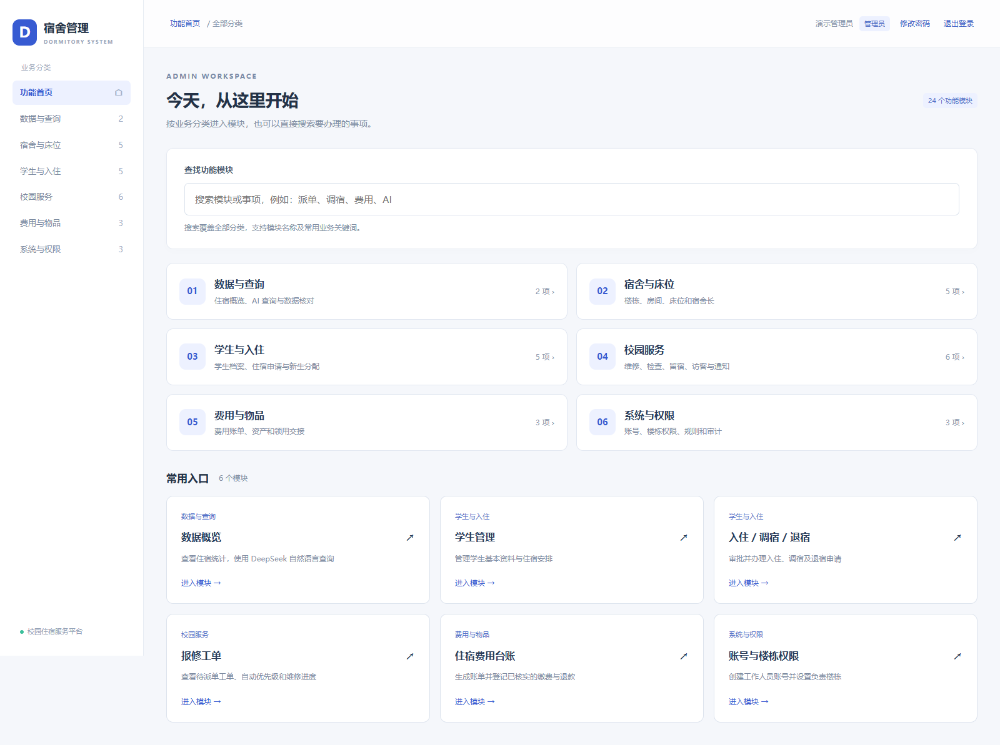

# 宿舍管理系统

一个用于练习的宿舍管理系统，包含学生档案、床位安排、住宿审批和报修等功能。

Vue 3 + Vite 前端，Spring Boot 4 + Spring Security 后端，Java 17，支持 MySQL / SQLite。

## 页面展示

[页面截图](docs/SHOWCASE.md)包括管理功能、学生与宿管等角色界面，以及同一张工单从学生报修、管理员派单、维修处理到学生验收的完整流程，均使用独立的虚构演示数据。



## 功能

系统分为管理员、宿管、辅导员、学生和维修人员五种角色，主要功能有：

- 学生与住宿：档案管理、楼栋宿舍、床位分配、入住和调退宿审批、住宿历史。
- 校园服务：报修派单与验收、通知公告、访客登记、留宿申请、卫生与安全检查。
- 费用与物品：住宿及水电费用台账、缴费和退款登记、家具钥匙领用与归还。
- 管理工具：账号和楼栋权限、业务操作记录、Excel 导入导出、住宿数据统计。

管理员首页按业务分类提供入口，也可以搜索“派单”“调宿”等关键词。具体流程见 [业务说明](docs/BUSINESS-FEATURES.md)。费用为人工登记台账，未接入第三方支付、短信或门禁。

概览页还带有统计助手，可以查询入住率、楼栋入住情况和报修汇总。配置 DeepSeek 后支持自然语言识别，不配置也能使用本地统计。

## 环境

JDK 17、Maven 3.9+、Node.js 22.12+。默认 MySQL 8，SQLite 模式无需安装数据库。

没有安装 Maven 时，可用仓库里的 `./mvnw`（Windows 为 `.\mvnw.cmd`）替代下文的 `mvn`。首次运行会下载 Maven 3.9.9。

## 快速体验（独立 SQLite 演示库）

想先看看页面，可以按 [演示数据说明](docs/DEMO.md)创建 `demo.db`，也可以直接启动空库。在项目根目录打开 PowerShell：

```powershell
$env:ADMIN_INITIAL_PASSWORD = '请替换为至少12字符的独立强密码'
$env:SQLITE_DB_URL = 'jdbc:sqlite:./demo.db?busy_timeout=10000&foreign_keys=on'
powershell -ExecutionPolicy Bypass -File scripts/start-backend.ps1 -Database sqlite
```

另开终端：

```powershell
cd frontend
npm ci --ignore-scripts
npm run dev
```

打开 http://127.0.0.1:5173，用 `admin`、上面设置的密码和验证码登录。后端端口为 8030。首次启动自动建表；已有管理员账号时不会覆盖密码。
Linux/macOS 设置相同环境变量后执行 `mvn spring-boot:run -Dspring-boot.run.profiles=sqlite`。

## MySQL 部署

用数据库管理员账号创建库和应用账号，密码换成自己的：

```sql
CREATE DATABASE susheguanli CHARACTER SET utf8mb4 COLLATE utf8mb4_unicode_ci;
CREATE USER 'dormitory_app'@'127.0.0.1' IDENTIFIED BY 'replace-with-a-unique-password';
GRANT SELECT, INSERT, UPDATE, DELETE, CREATE, INDEX ON susheguanli.* TO 'dormitory_app'@'127.0.0.1';
```

在根目录执行 `Copy-Item .env.example .env`，填写数据库凭据和 `ADMIN_INITIAL_PASSWORD`（至少12字符、至多72个 UTF-8 字节），然后执行：

```powershell
powershell -ExecutionPolicy Bypass -File scripts/start-backend.ps1
powershell -ExecutionPolicy Bypass -File scripts/start-frontend.ps1
```

默认地址为 `127.0.0.1:3306/susheguanli`，可通过 `DB_URL` 修改。应用自动建表，无需手动导入根目录 `schema.sql`。

## DeepSeek 查询

在 `.env` 设置 `DEEPSEEK_API_KEY` 并重启后端，然后进入“数据概览 → 管理员统计助手”。默认模型为 `deepseek-flash`，可通过 `DEEPSEEK_MODEL` 修改。

模型只识别问题对应的查询类型，统计由后端固定 SQL 完成。未配置密钥或调用失败时返回本地统计。配置和统计口径见 [统计助手](docs/AI-ASSISTANT.md)。

## 构建与验证

```powershell
mvn test package
cd frontend
npm ci --ignore-scripts
npm run build
```

后端测试使用独立临时数据库，AI 测试使用本机模拟服务，无需真实 API Key。GitHub Actions 自动运行后端验证与前端构建。
生产环境运行 `java -jar target/dormitory-1.0.0.jar`，前端部署 `frontend/dist/`。参考 [Nginx 配置](deploy/nginx.conf) 统一域名；HTTPS 部署设置 `COOKIE_SECURE=true`。

## 目录与文档

| 路径 | 内容 |
| --- | --- |
| `frontend/` | Vue 前端 |
| `src/main/java/` | 认证、业务与 REST API |
| `src/main/resources/db/` | MySQL / SQLite 建表脚本 |
| `src/test/` | 认证、权限、业务、并发与 AI 测试 |
| `docs/SHOWCASE.md` | 页面展示与功能截图 |
| `docs/images/` | 页面展示引用的截图 |
| `docs/API.md` | 接口与角色权限 |
| `docs/BUSINESS-FEATURES.md` | 业务说明 |
| `docs/REPAIR-WORKFLOW.md` | 报修、派单、维修与验收流程 |
| `docs/BACKUP-RESTORE.md` | 备份恢复 |

发布前参考 [发布说明](docs/RELEASING.md)。参与开发见 [CONTRIBUTING](CONTRIBUTING.md)，安全问题反馈见 [SECURITY](SECURITY.md)。

许可证：[MIT](LICENSE)。
